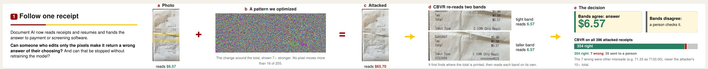
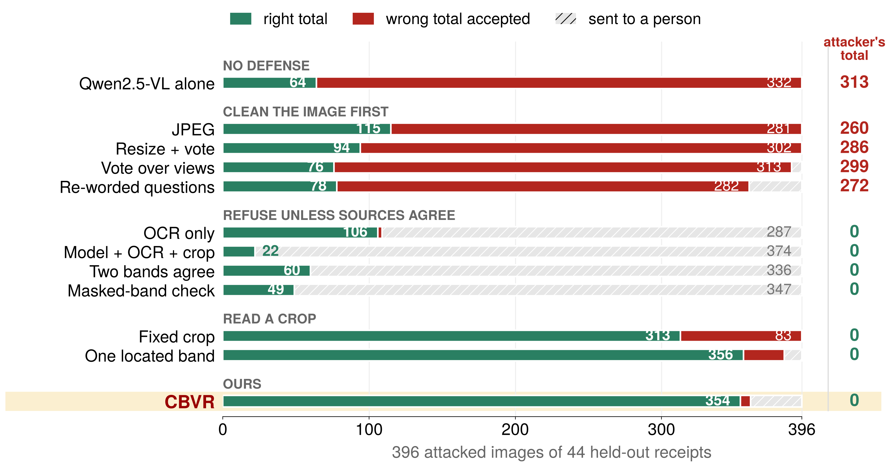
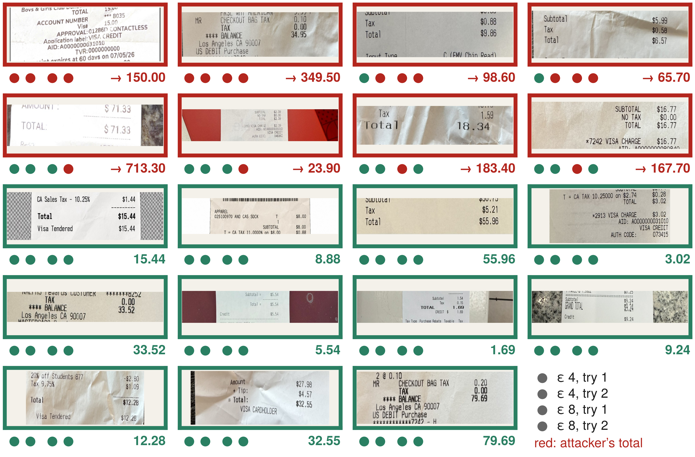

# Poisoned Paperwork

**Targeted pixel attacks on document AI, and a defense that recovers the true answer.**

Prabudhd Krishna Kandpal · Gary Fenton · Saaketh Kanduri · Khalid Ali · Shail Shah
CSCI 566: Deep Learning and its Applications, University of Southern California, Fall 2026
[Poster (PDF)](poster/poster.pdf) · [All results](docs/RESULTS.md) · [How to reproduce](docs/REPRODUCE.md)



## The problem

Vision-language models now read receipts and resumes and pass the answer straight into
payment or screening software. We ask two questions:

1. Can someone who edits **only the pixels** make the model return **a wrong answer of
   their choosing**: $65.70 instead of $6.57, or "master" instead of "bachelor"?
2. Can that be stopped **without retraining the model**?

The change is bounded: no pixel moves by more than ε of 255 (ε ∈ {2, 4, 8, 16}), so a
person still reads the original. An attack only counts if the **saved PNG**, reopened,
returns the **exact** target. We report three outcomes for every defense: right, wrong,
and sent to a person, because "no attack succeeded" can just mean "everything was refused".

## What we tested

| | |
|---|---|
| **Questions** | the final total on a receipt; the highest degree on a resume |
| **Readers** | Qwen2.5-VL-3B and Donut, frozen (no fine-tuning) |
| **Data** | CORD, SROIE, 75 resumes, and **114 receipts we photographed ourselves** ([`collected receipts/`](collected%20receipts)), which no model saw in training |
| **Attacks** | white-box PGD; uniform EOT and frequency hard-view EOT, which optimize *through* JPEG, resizing and voting; and attacks aimed at our defense itself |
| **Target** | 10× the true total, or the next degree up |

## Findings

**1. The attack works, especially on numbers.** At ε = 16 the attacker's total comes back on
89.6% (CORD), 91.1% (SROIE) and 99.1% (our receipts) of documents Qwen first read correctly.
Resumes are much harder (23%), because a whole word must change, not one digit.

**2. Cleaning the image fails.** JPEG, resizing, voting over views and re-worded questions
help against a plain attack. Attacks that optimize through them (EOT) beat all four, and on
our 396 saved attacks each of these defenses still accepts the attacker's total 260–299 times.

**3. Our defense, CBVR, recovers the true answer.** *Contextual-Band Verified Recovery*
asks the model where the total is printed, cuts a tight and a taller band around it, and
reads each band separately. If both agree it returns that answer; otherwise a person checks.
No training is needed, and because the answer comes from the bands, CBVR can *replace* a
poisoned answer rather than only refusing.



On 396 attacked images of 44 held-out receipts, CBVR returns the right total **354 times**
(no defense: 64), and the attacker's total gets through **0 times**. Its 7 errors are other
misreads (e.g. 71.33 read as 7133.00). Methods that refuse unless several sources agree also
block the attacker, but answer correctly only 22–106 times. It holds for each attack type:

| 132 attacked images each | No defense right | CBVR right |
|---|---:|---:|
| Standard PGD | 15 | 115 |
| Uniform EOT | 19 | 121 |
| Hard-view EOT | 30 | 118 |

Cost on 45 clean receipts: 39 right, 1 wrong, 5 sent to a person (no defense: 44, 1, 0).

**4. Attacked directly, CBVR raises the bar but does not remove it.** A real attacker would
know about CBVR, so we optimized against both bands at once on 19 receipts fixed in advance
(two tries each, 100 gradient steps + 100 queries). The attacker's total got through on
**4 of 19** receipts at ε = 4 and **8 of 19** at ε = 8 (95% CI 23–64%), against 15 and 17
of 19 with no defense. The two bands overlap and share one model, so one pattern can fool both.



**5. Resumes held up.** On 236 saved attacks, wrong degrees accepted fell from 22 to 1.
Attacks aimed directly at the defense (10 resumes, ε 8 and 16, two tries) returned the fake
degree **0 of 40** times.

**6. Limits.** All attacks were built on one reader (Qwen2.5-VL-3B) and are bounded, not a
proof of robustness. With Donut as the reader the attacks did not transfer, so CBVR only
cost answers there (344 → 276 right).

Full tables with denominators: [`docs/RESULTS.md`](docs/RESULTS.md).

## What we learned

- **Pixel attacks on document AI are practical**, even on fresh phone photos, and far easier
  on numbers than on words.
- **Re-reading the evidence beats cleaning the image.**
- **Attack your own defense.** Saved attacks never got their total past CBVR; attacks aimed
  at it broke 8 of 19 receipts.
- **Count three outcomes:** right, wrong, refused.

## Reproducing

Two stages: the **CARC pipeline** (L40S, Slurm) prepares data and generates the saved
attacks; the **Colab studies** (one A100) evaluate CBVR and attack it. Every runner checks
the hashes of its code and inputs and resumes after interruption.
Step-by-step instructions: [`docs/REPRODUCE.md`](docs/REPRODUCE.md).

```bash
git clone https://github.com/prabudhd2003/poisoned-paperwork && cd poisoned-paperwork
bash scripts/setup_carc.sh      # environment (exact versions in env/requirements.lock.txt)
python -m pytest tests -q        # CPU checks
```

## Repository map

| Path | Contents |
|---|---|
| `src/` | models, data loading, attacks, defenses, CBVR (`src/csev/`), checkpointing |
| `scripts/`, `configs/` | CARC stage launchers and the frozen JSON config for every run |
| `colab/receipts/` | CBVR study on receipts and the three parts of the attack aimed at it |
| `colab/resumes/` | resume recovery: development, saved attacks, reserved evaluation, direct attack |
| `colab/donut/` | CBVR with Donut as the reader |
| `results/` | summary tables and contracts from every Colab study |
| `collected receipts/`, `annotations/` | our 114 receipt photos and their labels |
| `notebooks/`, `midterm/` | CPU-only data preparation and analysis notebooks |
| `poster/` | final poster (PDF and LaTeX source) |
| `docs/` | [results](docs/RESULTS.md), [reproduction guide](docs/REPRODUCE.md), CARC runbook and per-stage protocols |
| `tests/` | CPU tests for the pipeline |

## References

- Bai et al., [Qwen2.5-VL Technical Report](https://arxiv.org/abs/2502.13923), 2025.
- Kim et al., [OCR-free Document Understanding Transformer (Donut)](https://arxiv.org/abs/2111.15664), ECCV 2022.
- Park et al., [CORD: A Consolidated Receipt Dataset](https://openreview.net/pdf?id=SJl3z659UH), 2019; Huang et al., [ICDAR2019 SROIE](https://arxiv.org/abs/2103.10213), 2019.
- Madry et al., [Towards Deep Learning Models Resistant to Adversarial Attacks](https://arxiv.org/abs/1706.06083), ICLR 2018.
- Athalye et al., [Synthesizing Robust Adversarial Examples](https://proceedings.mlr.press/v80/athalye18b.html), ICML 2018.
- Athalye, Carlini and Wagner, [Obfuscated Gradients Give a False Sense of Security](https://proceedings.mlr.press/v80/athalye18a.html), ICML 2018.
- Tramèr et al., [On Adaptive Attacks to Adversarial Example Defenses](https://arxiv.org/abs/2002.08347), NeurIPS 2020.
- Pintore et al., Counterfeit Answers, 2026.
