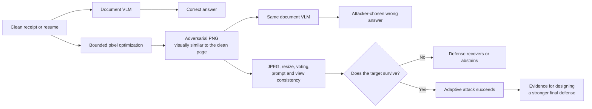
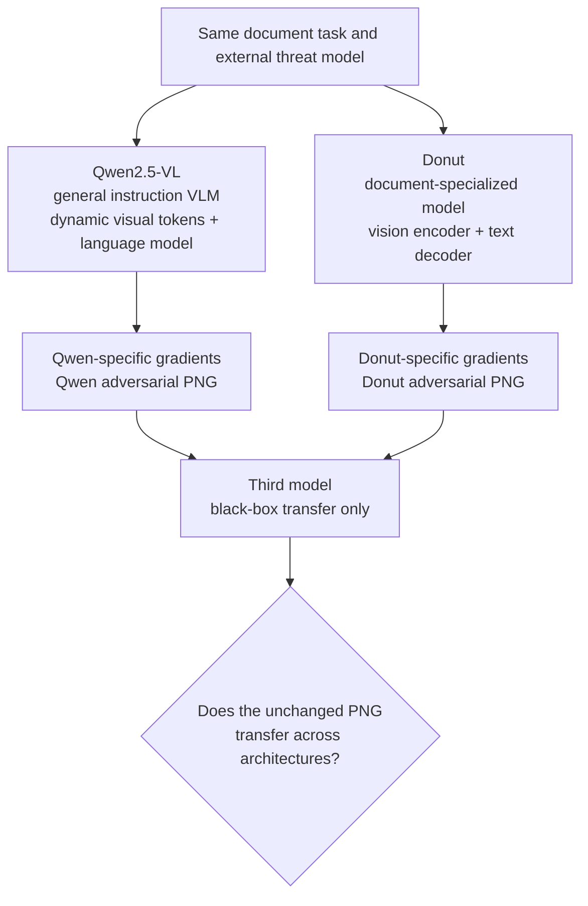
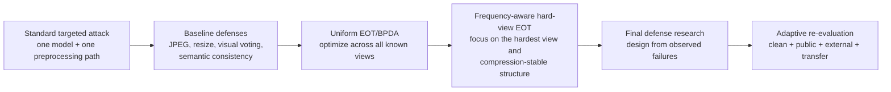
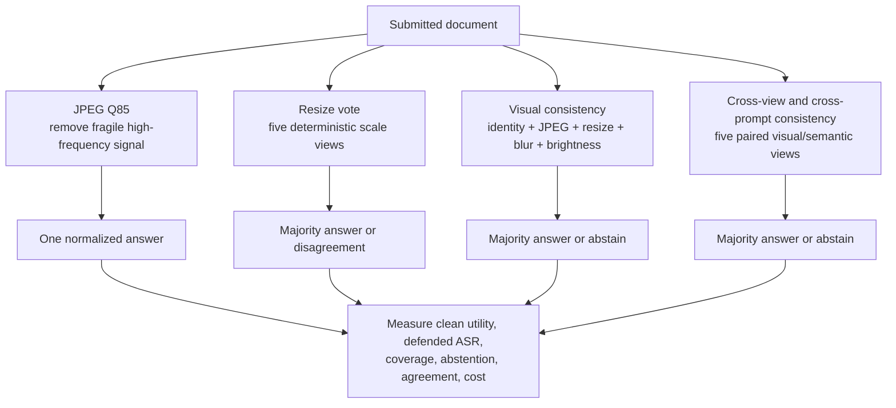
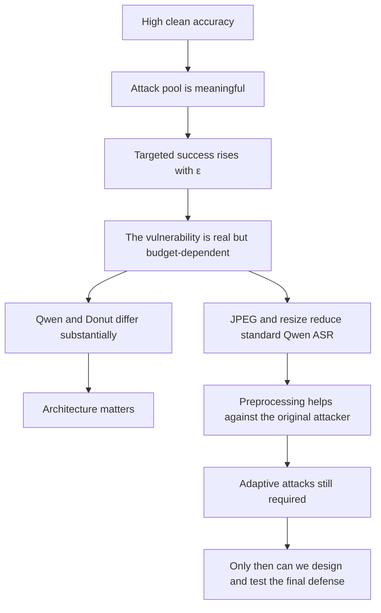
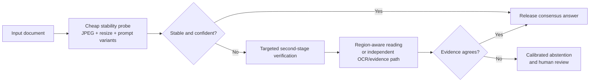

# Poisoned Paperwork

Poisoned Paperwork studies targeted adversarial attacks and defenses for
document vision-language models (VLMs). The central question is not merely
whether changing pixels can change a prediction. We ask how reliably an
attacker can force a specific wrong answer, how visible that manipulation is,
whether ordinary document processing removes it, and whether those defenses
remain useful after the attacker learns how they work.

The primary task is receipt-total extraction. The secondary task is identifying
the highest degree stated in a resume. Together they test numerical extraction
and semantic document classification across two model families, public data,
and a prospectively collected external dataset.

## The project in one picture



The core risk is simple: the visible words and numbers do not need to change
for the machine's answer to change. The scientific challenge is harder. We
must show that the wrong answer is **specific**, the pixel change is
**bounded**, the saved file still works after reopening, the effect is not
limited to one public dataset or one architecture, and any proposed defense is
tested against an attacker who knows it exists.

### What has been established so far

- Targeted attacks work on Qwen and Donut, but their effectiveness depends
  strongly on model, task, and pixel budget.
- Qwen reaches 89.6–91.1% targeted success on the two public receipt datasets
  at ε = 16, while the harder resume task reaches 23.0%.
- Donut reaches 81.8% combined public-receipt success at ε = 16 on its own
  clean-correct set.
- A complete 4,688-record Qwen defense study found that simple JPEG and resize
  baselines currently outperform the more elaborate consistency ensembles
  against the original, non-adaptive attack.
- That is not the final robustness claim: two defense-aware attacks are the
  next test, followed by a new defense designed from their measured failure
  modes.

> **Required reading for contributors and coding agents:** read
> [`AGENTS.md`](AGENTS.md) and
> [`docs/CARC_END_TO_END.md`](docs/CARC_END_TO_END.md) before changing
> experiment code or launching jobs. Cluster commands, worker ownership,
> environment requirements, restart rules, and completion checks deliberately
> live in that separate operational runbook rather than this scientific README.

## Why this project matters

Document VLMs increasingly read receipts, invoices, applications, resumes, and
other records that can influence financial or administrative decisions. An
image can appear normal to a person while causing a model to return an
attacker-chosen total or education category. At the same time, a defense that
simply destroys image quality, rejects every document, or changes clean answers
is not useful.

The project therefore measures an attack–defense trade-off:

1. Can a bounded perturbation force an exact target answer?
2. At what perturbation budget does this become reliable?
3. Does the attacked page remain visually similar to the original?
4. Do JPEG, resizing, multi-view voting, or prompt consistency remove it?
5. Can an informed attacker adapt to those defenses?
6. Do conclusions hold on newly collected receipts and another model?

### Who should care?

This problem matters anywhere an image becomes a structured decision:

- **Expense and accounts-payable systems:** a wrong extracted total can alter
  reimbursement, payment, or fraud-screening workflows.
- **Hiring and admissions systems:** a changed degree prediction can affect
  filtering or ranking even though the resume still looks unchanged.
- **Banks, insurers, and public agencies:** invoices, claims, applications, and
  identity documents increasingly pass through automated document pipelines.
- **Model and platform developers:** high clean benchmark accuracy does not
  imply adversarial reliability, especially when an attacker controls the
  uploaded image.
- **Auditors and security teams:** a useful defense must preserve clean
  accuracy, expose uncertainty, and survive an informed attacker—not merely
  lower attack success by rejecting everything.

Recent studies have found that large multimodal models remain vulnerable to
visual adversarial inputs, including targeted and transferable attacks
[^cui2024] [^vqattack2024]. Very recent document-specific work also shows that
model-aware visual perturbations can substantially degrade end-to-end document
VLMs while preserving legible source content [^arawm2026]. Poisoned Paperwork
focuses this broader problem on exact, high-consequence document fields and an
explicit attack–defense arms race.

### What success would mean

If the project succeeds, it will provide more than a demonstration that neural
networks react to perturbed pixels. It will provide:

1. a reproducible robustness benchmark spanning public and newly collected
   documents;
2. a matched comparison between a general instruction VLM and a
   document-specialized encoder–decoder;
3. evidence about which inexpensive defenses help before and after adaptive
   attack;
4. evidence about whether attacks transfer to a model that supplied no
   gradients; and
5. a new defense whose design is motivated by observed failure modes and whose
   clean utility, robustness, abstention, and cost are all measured.

Success would **not** prove that every document model or real deployment is
unsafe, nor would low transfer prove safety. It would establish a controlled,
auditable failure mode and a stronger way to evaluate candidate mitigations.

## Tasks, datasets, and models

### Receipt-total extraction

The model receives a receipt image and must return only its final transaction
total. Public experiments use:

- **SROIE** [^sroie], with 123 clean-correct Qwen validation documents out of
  126;
- **CORD v2** [^cord], with 96 clean-correct Qwen validation documents out of
  100.

The targeted public-receipt attack asks the model to return a frozen incorrect
amount equal to ten times the canonical clean total. Exact decimal handling is
used so formatting differences do not silently change the target definition.

### Resume highest-degree classification

The model receives every page of a resume and returns one label from a frozen
education taxonomy. Qwen is clean-correct on 74 of 75 validation resumes. The
target is a fixed upward change, such as `bachelor → master` or
`master → doctorate`.

### Independently collected receipts

The team collected 114 new receipt photographs and is manually auditing their
final-total annotations.
They are converted to PNG, audited one at a time, and kept as a separately
labeled external test set. These documents were not selected from the public
benchmark and are the main response to the concern that an open-source VLM may
have memorized public data. Public and collected results are never pooled into
one denominator.

### Models

- **Qwen2.5-VL-3B-Instruct** is the main differentiable VLM and supports the
  full adaptive attack study.
- **Donut** supplies a second document-model architecture with its own clean
  baselines and targeted attacks.
- A separate vision-language model is used for black-box transfer evaluation;
  it never supplies gradients to the source attack.

Qwen2.5-VL was designed for native-resolution visual understanding and
document parsing [^qwen2025]. Donut was designed as an OCR-free document
understanding transformer [^donut2022]. Their different processing and
generation paths make agreement between them much more informative than two
runs of the same architecture.



Using both Qwen and Donut is essential to the scientific question rather than
an attempt to repeat the same experiment twice. Qwen is a modern instruction-
tuned vision-language model: it converts visual content into tokens and
answers a natural-language question with a large autoregressive language
model. Its behavior can depend strongly on prompt wording, multi-page context,
and the model's broad pretraining. Donut is a document-specialized encoder-
decoder model: its visual encoder maps the document into features and its text
decoder produces the answer under a DocVQA task format. It uses a different
image processor, tokenization path, decoder, parameter scale, and training
history.

That architectural separation lets the project distinguish two very different
claims:

1. **Model-specific vulnerability:** an attack may exploit Qwen's visual-token
   or prompt pathway but fail on Donut.
2. **Document-model vulnerability:** similar attack/defense trends across both
   architectures suggest a broader weakness in neural document understanding,
   not an isolated implementation quirk.

The comparison is deliberately matched. Each model is attacked only on its own
clean-correct documents, uses the same task target, pixel-space budgets,
saved-PNG verification, perceptual metrics, four defenses, and adaptive-method
families. We do not force the models to share an optimizer or internal loss
when their architectures require different differentiable objectives; instead,
we hold the external threat model and evaluation contract constant.

The third model has a different role. It is a **black-box transfer evaluator**,
not another white-box source model. Adversarial PNGs are created using Qwen or
Donut gradients and then shown unchanged to the third model. No gradients,
logits, or tuning feedback from that model are allowed during attack creation.
This answers whether the perturbation merely overfits one model's internal
decision surface or captures visual structure that generalizes across model
families. Transfer success is stronger evidence of a systematic document-AI
failure; low transfer is still informative because it shows that the attack is
primarily source-model-specific.

This separation follows the motivation of transfer-focused VQA attacks, which
ask whether adversarial behavior learned on one multimodal model carries to
another [^vqattack2024]. Our transfer model is therefore not allowed to become
another optimization oracle.

The third-model test also strengthens the response to the memorization concern.
A public example answered correctly by one open model could reflect exposure
during pretraining, but a prospectively generated perturbation that transfers
to a separately trained model is harder to explain as simple retrieval of a
memorized answer. This evidence is combined with the independently collected
114-receipt external set; neither transfer alone nor external data alone is
treated as definitive proof against memorization.

## Experimental contract

### Threat model

| Question | Frozen answer in this project |
|---|---|
| What can the attacker change? | RGB pixels of the submitted document image |
| What must remain unchanged? | The task question, semantic document content, dimensions, and file role |
| What does the attacker know? | White-box model and preprocessing for source attacks; completed defenses for adaptive attacks |
| What is the goal? | An exact attacker-selected total or degree label, not merely any error |
| How large may the change be? | An `L∞` budget of ε/255 per channel, principally ε ∈ {2, 4, 8, 16} |
| What artifact is evaluated? | A quantized RGB PNG saved to disk and reopened |
| What counts as success? | The reopened PNG produces the exact normalized target |
| What is outside the present claim? | Physical printing/re-photography, arbitrary proprietary APIs, and unrestricted semantic document edits |

For a clean image `x`, target answer `yₜ`, model `f`, and target loss `L`,
the standard attack approximately solves:

```text
minimize    L(f(x′), yₜ)
subject to  ‖x′ − x‖∞ ≤ ε/255  and  x′ ∈ [0,1]ᵈ
```

The adaptive version optimizes the expected target loss over a frozen set of
real image transformations and equivalent prompts. This follows the robust
optimization view of projected attacks [^madry2018] and the EOT/BPDA principles
used to evaluate transformed or non-differentiable defenses
[^eot2018] [^bpda2018].

Attacks are evaluated only on documents the relevant model originally answered
correctly. This conditional denominator prevents ordinary model errors from
being counted as successful attacks.

Every saved adversarial artifact is an RGB PNG constrained by an image-space
L-infinity budget measured in ordinary 0–255 pixel levels. The principal
budgets are ε = 2, 4, 8, and 16. The saved PNG is reopened and evaluated again;
success is never inferred only from an in-memory optimization tensor.

The principal metrics are:

- exact targeted attack success rate (ASR), with the numerator and denominator;
- LPIPS and SSIM for perceptual similarity;
- measured L-infinity distance after saving and reloading;
- clean accuracy, defense coverage, abstention, agreement, and entropy;
- runtime, optimization steps, model passes, and peak GPU memory;
- success after each real defense transformation;
- transfer success on a model that did not generate the gradient.

All production runs use frozen configurations, model revisions, prompts,
dataset counts, source hashes, deterministic sharding, checkpoint contracts,
and strict merged-result validation.

## Attack progression

The attacks deliberately form a sequence rather than a collection of unrelated
demos.



| Attack | What it is trying to learn | Why it is needed |
|---|---|---|
| Standard targeted attack | A bounded image that makes one source model emit one exact wrong answer | Establishes the basic vulnerability and the ε–success curve |
| Uniform EOT/BPDA | One image that remains targeted across known image and prompt transformations | Tests whether baseline defenses only remove fragile perturbations |
| Frequency-aware hard-view EOT | Perturbations biased toward transform-stable frequencies while emphasizing the currently hardest view | Tests a stronger attacker against JPEG, resizing, and consistency ensembles |
| Black-box transfer | No new optimization—the same saved PNG is evaluated on an unseen model | Separates source-model overfitting from cross-architecture vulnerability |

### 1. Standard targeted full-page attack

The first attack uses teacher-forced targeted cross-entropy and projected
gradient descent. Qwen's official image processor is used in the forward pass.
A differentiable surrogate with an exact-forward BPDA construction supplies
the backward path, so optimization sees the same processed pixels used by the
model while still receiving image gradients.

After every update, the image is projected into the ε-bounded RGB region and
quantized. Checkpoints retain the lowest-loss and verified successful
candidates. The final result is accepted only after the saved PNG is reloaded
and produces the exact target.

This is a targeted form of projected first-order optimization rather than an
untargeted “make the model wrong somehow” attack. Exact targets make the claim
stronger and easier to audit: predicting `17.20` instead of the chosen
`172.00` does not count as success.

### 2. Uniform multi-view EOT/BPDA attack

The first adaptive attack assumes the attacker knows the completed defenses.
It uses Expectation over Transformation (EOT) and BPDA across:

- identity;
- JPEG qualities 65, 75, 85, and 95;
- fixed and exact per-document randomized resize views;
- Gaussian blur;
- brightness adjustment;
- five semantically equivalent task prompts.

Three frozen views are sampled per optimization step. Real Pillow transforms
run in the forward pass and an identity straight-through approximation supplies
the transformation gradient. Every twenty steps, the saved PNG is tested
against the exact four defense protocols. Candidate selection first maximizes
the number of defenses defeated and then uses target loss as the tie-breaker.

EOT means that the optimizer does not bet everything on one rendering of the
page. BPDA means that the forward pass still uses the real, possibly
non-differentiable transformation, while the backward pass uses a documented
gradient approximation. This distinction is important because evaluating a
randomized or preprocessing defense with a naive gradient can create a false
sense of security [^bpda2018] [^randomtransforms2022].

This full run contains all 293 public clean-correct documents at ε = 4, 8, and
16, for 879 adaptive attacks. ε = 2 remains the completed negative control from
the standard attack, where it achieved 0/293 successes.

### 3. Frequency-aware hard-view EOT/BPDA attack

The second adaptive method uses the same documents, budgets, transformations,
prompts, targets, and final defense evaluation, but strengthens the optimizer
in two ways.

**Hard-view weighting.** At each checkpoint, the attack measures target loss
for every visual/prompt view. A temperature-controlled distribution gives more
sampling probability to the highest-loss views while retaining a nonzero floor
for every view. The optimizer therefore concentrates on whichever defense is
currently hardest instead of spending equal work on views it already defeats.

**Frequency-aware updates.** A smooth FFT low-pass component is mixed into both
the gradient direction and the perturbation itself before L-infinity projection
and quantization. JPEG and resizing preferentially suppress fragile
high-frequency noise, so this biases the attack toward spatial structure more
likely to survive those operations while preserving the identical pixel budget.

The method is evaluated separately from uniform EOT. It is considered better
only if it raises defended ASR without an unacceptable LPIPS, SSIM, or runtime
cost. The repository does not claim that either adaptive method is guaranteed
to defeat every document.

## Defenses

All four defenses were run on every one of the 293 public clean-correct
documents at ε = 4, 8, and 16. Clean examples are evaluated as well so a defense
cannot appear effective merely by rejecting or corrupting inputs. The completed
study contains 4,688 records with zero logged failures:

- 293 documents × 4 clean-defense evaluations = 1,172;
- 293 documents × 3 ε values × 4 attack-defense evaluations = 3,516.



| Defense | Intended mechanism | Main advantage | Main risk |
|---|---|---|---|
| JPEG Q85 | Quantization suppresses perturbation components that do not survive compression | One model call; strong current baseline | An adaptive attacker can optimize through JPEG |
| Resize voting | A target must survive several resampling paths | Adds diversity with simple operations | More calls; correlated views can still fail together |
| Selective visual multi-view | Requires agreement across ordinary visual changes | Can abstain on unstable documents | Abstention can hide poor utility if not reported |
| Cross-view/cross-prompt consistency | Requires stability across both pixels and wording | Tests visual and semantic overfitting jointly | Highest inference cost; agreement is not proof of correctness |

### JPEG Q85

The page is recompressed using real JPEG quality 85 with fixed chroma handling,
then decoded and sent to Qwen. This is inexpensive and particularly effective
against non-adaptive high-frequency perturbations, but may be vulnerable once
the attacker optimizes through JPEG.

### Randomized resize voting

Five deterministic, record-specific downsample/upsample views are generated
with scales between 0.70 and 1.00. Qwen predicts each view and the majority
wins. Randomization makes one fixed preprocessing path less predictable, while
the frozen seed keeps the experiment reproducible.

### Selective visual multi-view consistency

The model sees identity, JPEG, resize, blur, and brightness views under the same
prompt. At least three of five normalized answers must agree; otherwise the
system abstains. This tests whether the answer is stable under small ordinary
document transformations.

### Cross-view and cross-prompt semantic consistency

The project-specific ensemble pairs the same five visual transformations with
five semantically equivalent prompts. It releases an answer only with a
three-of-five majority and records agreement, normalized entropy, abstention,
runtime, and added VLM calls. This targets attacks that overfit one exact prompt
or one visual preprocessing path.

These are initially **non-adaptive defenses** because the standard attack did
not know which defense would be applied. Both full adaptive attack runs then
evaluate the same defenses under a stronger white-box threat model.

No defense is called “best” from attack success alone. A defense that always
abstains would have zero released targeted answers but would also be useless.
The comparison therefore reports clean accuracy, coverage, abstention,
agreement, entropy, model calls, and runtime alongside defended ASR. Recent
training-free VLM defense research similarly explores prompt decomposition and
aggregation as robustness signals [^pda2026], while certified multimodal work
shows a different, guarantee-oriented direction beyond empirical preprocessing
[^mmcert2024].

## Current results

### Clean Qwen performance

| Dataset | Correct | Total | Clean accuracy |
|---|---:|---:|---:|
| CORD v2 | 96 | 100 | 96.0% |
| SROIE | 123 | 126 | 97.6% |
| Resumes | 74 | 75 | 98.7% |

The high clean accuracy makes the robustness evaluation meaningful: nearly all
documents enter the clean-correct attack pool, especially for resumes.

### Standard targeted Qwen attack

| Dataset | ε=2 | ε=4 | ε=8 | ε=16 |
|---|---:|---:|---:|---:|
| CORD v2 | 0.0% | 62.5% | 87.5% | 89.6% |
| SROIE | 0.0% | 37.4% | 67.5% | 91.1% |
| Resumes | 0.0% | 1.4% | 5.4% | 23.0% |

These results show three important patterns.

1. **ε = 2 is a meaningful negative control.** It produced no targeted success
   on any of the 293 documents, so a nonzero perturbation budget alone does not
   guarantee an attack.
2. **The task matters.** Receipt totals are substantially easier to redirect
   than resume degree classification under the same model and budget.
3. **Effectiveness grows with ε.** This creates an explicit robustness–visibility
   curve that must be interpreted together with LPIPS, SSIM, and visual review.

### Existing defenses against the standard attack

| Condition | ε=4 | ε=8 | ε=16 |
|---|---:|---:|---:|
| No defense, saved attack outputs | 36.5% | 58.4% | 73.4% |
| JPEG Q85 | **4.4%** | **15.7%** | 41.0% |
| Resize vote | 11.6% | 22.5% | **39.9%** |
| Selective visual multi-view | 23.9% | 38.2% | 54.6% |
| Semantic consistency | 15.4% | 31.1% | 44.4% |

JPEG is strongest at ε = 4 and 8. Resize voting is slightly stronger at ε =
16. The more elaborate consistency ensembles are useful but do not dominate the
simple preprocessing baselines in this non-adaptive setting. That is a result,
not a failure: complexity alone does not make a defense better.

The table does not yet establish robustness against an informed attacker.
Uniform EOT and frequency-aware hard-view EOT are designed to measure how much
of each reduction survives after the attacker adapts.

### Standard targeted Donut attack

Khalid's full public Donut study has now passed the cross-run audit. All five
epsilon settings use the identical 121 Donut-clean-correct receipts (75 CORD
v2 and 46 SROIE), the pinned Donut revision, the same 10× target policy,
100-step Adam optimization with the paper-margin loss, per-step quantization,
and saved/reloaded PNG verification. The three epsilon-split runs contain 605
records in total, with no logged failures and no Donut implementation changes
between their recorded Git commits.

| Dataset | ε=2 | ε=4 | ε=8 | ε=16 | ε=32 stress test |
|---|---:|---:|---:|---:|---:|
| CORD v2 | 6/75 (8.0%) | 12/75 (16.0%) | 38/75 (50.7%) | 70/75 (93.3%) | 73/75 (97.3%) |
| SROIE | 1/46 (2.2%) | 5/46 (10.9%) | 12/46 (26.1%) | 29/46 (63.0%) | 42/46 (91.3%) |
| Combined | 7/121 (5.8%) | 17/121 (14.0%) | 50/121 (41.3%) | 99/121 (81.8%) | 115/121 (95.0%) |

The primary matched Qwen/Donut protocol reports the standard attack at ε = 2,
4, 8, and 16. Defenses and adaptive attacks use ε = 4, 8, and 16 for both
models. This preserves an identical comparison grid; the nonzero Donut ε = 2
result remains visible in the standard-attack table rather than being erased.
Donut ε = 32 is retained only as a clearly labeled high-budget stress test and
is excluded from the matched defense and adaptive analyses. Its lower SSIM and
higher LPIPS make it inappropriate to mix with the main bounded comparison.

These results establish model-specific vulnerability on different clean-correct
cohorts. They do not establish a universal robustness ranking. A matched
intersection analysis is required, together with perceptual quality. The project therefore reports ASR together with
LPIPS, SSIM, and native-resolution visual examples rather than treating the
largest ASR as automatically best.

### What the evidence means today



The current evidence supports four claims and leaves four questions open:

| Supported now | Still to be answered |
|---|---|
| Exact targeted manipulation is possible on both model families | How much of the defense gain survives full adaptive attack? |
| Attackability depends on task, model, and ε | Do the same trends hold on all 114 collected receipts? |
| Simple preprocessing can strongly reduce the original Qwen attack | Which attacks transfer unchanged to the third model? |
| More elaborate ensembles are not automatically stronger | Can a new defense beat JPEG/resize without sacrificing clean utility or cost? |

The result is therefore neither “the models are completely broken” nor “JPEG
solves the problem.” It is a measured robustness curve followed by an
unfinished adaptive test.

## Execution status as of November 1, 2026

Completed and validated:

- Qwen clean baselines and standard attacks on CORD v2, SROIE, and resumes;
- the full 4,688-record Qwen non-adaptive defense evaluation;
- Donut standard public attacks on the same CORD/SROIE task at ε = 2, 4, 8,
  and 16, plus the separately archived ε = 32 stress test;
- collection, annotation, PNG conversion, hashing, and freezing of 114 unique
  external receipts.

Submitted on CARC at the time of this update:

- five combined Qwen/Donut clean-baseline workers for all 114 external
  receipts;
- five Qwen uniform multi-view EOT/BPDA workers;
- five Qwen frequency-aware hard-view EOT/BPDA workers.

Implemented and CPU-tested, but deliberately not yet submitted from the active
CARC checkout:

- an audited Donut-result importer that copies all 484 primary ε = 2/4/8/16
  PNGs into the main project, verifies every hash, and excludes ε = 32 from
  the primary source table;
- the same four defenses for Donut, with clean utility, abstention, agreement,
  cost, post-defense ASR, and recovery metrics;
- full Donut uniform multi-view EOT/BPDA at ε = 4/8/16;
- full Donut frequency-aware hard-view EOT/BPDA at ε = 4/8/16;
- matched Qwen/Donut defense and adaptive-analysis notebook cells.

The new Donut code will be pulled into CARC only after the currently submitted
workers finish, preventing pending workers from starting on mixed Git commits.
Every Donut GPU stage must still pass its CARC smoke test before the full five
workers are submitted.

## How the results guide the final defense

The final defense is a research hypothesis, not a predetermined novelty or
performance claim. The new evidence-grounded selective inference protocol
checks independently extracted OCR evidence against full-document and localized
region predictions. Its proposed contribution is the evaluation of whether
field-level evidence agreement improves the adaptive risk-coverage trade-off
over OCR alone and the existing preprocessing defenses. OCR, ensembles,
localization, and abstention are established ideas.

See [the final research protocol](docs/FINAL_RESEARCH_PROTOCOL.md) for related
work, falsifiable hypotheses, ablations, and attack limitations. The implementation
uses separate final-protocol run IDs, full clean cohorts, and source-specific
transfer denominators. It has no measured GPU results yet.

The candidate is motivated by the interim adaptive failure pattern. After
both adaptive runs finish, we will compare, for each
dataset and ε:

- defended ASR for all four defenses;
- the strict fraction of PNGs that defeat all four;
- which visual or prompt views remain hardest;
- LPIPS/SSIM and visual quality;
- abstention, clean utility, latency, and model-call cost;
- uniform-EOT versus frequency-hard-view improvement.

The final defense will target the measured weakness. For example, if
low-frequency attacks survive JPEG but disagree across prompts, the design
should emphasize semantic verification. If they remain prompt-consistent but
fail under particular transformations, the defense should select or randomize
those transformations. Any proposed defense must then be evaluated on clean
documents, the original attacks, both adaptive attacks, and the external
receipts. This produces an evidence-driven attack–defense arms race rather than
a defense selected because it sounds sophisticated.

### Candidate design space for the final defense



This is a research direction, not a claimed completed method. Depending on the
adaptive results, the final design may combine:

- **conditional computation:** inexpensive checks for easy/stable documents
  and stronger verification only for suspicious ones;
- **evidence localization:** require the answer to be supported by a coherent
  document region instead of trusting only the generated token;
- **heterogeneous agreement:** compare a VLM answer with an OCR or differently
  structured document model so every view does not share one failure mode;
- **adaptive view selection:** choose transformations that exposed the largest
  attack instability rather than using a fixed ensemble blindly;
- **calibrated abstention:** reject only when measured disagreement exceeds a
  threshold chosen on clean validation data; and
- **attack-aware training or reconstruction:** considered only if the
  training-free methods remain insufficient and the compute/clean-accuracy
  cost can be measured fairly.

The final defense will be compared with JPEG Q85 and resize voting, not only
with “no defense.” It must be evaluated on standard attacks, both adaptive
attacks, clean inputs, external receipts, and transfer examples. A method that
wins only against the attack used to design it will not be presented as a
general defense.

### Questions that can deepen the project

1. Which spatial frequencies and document regions carry successful targeted
   perturbations for totals versus degrees?
2. Are successful attacks tied to the printed answer region, or distributed
   across layout and background pixels?
3. Does cross-model transfer correlate with LPIPS, SSIM, frequency content, or
   agreement across prompts?
4. Can a detector identify attacks without learning the exact perturbations
   used during evaluation?
5. Can the final defense produce a useful risk score rather than only a hard
   answer/abstain decision?
6. How much robustness is gained per additional model call and per second of
   latency?

## Response to the proposal feedback

The project directly addresses the three concerns raised at proposal time.

**“The project may be trivial because perturbations should affect the model.”**
We require exact attacker-chosen outputs, bounded and reloaded PNGs, multiple ε
values, perceptual metrics, clean-correct denominators, two tasks, and defended
evaluation. The ε = 2 and resume results show that influence is not automatic.

**“The attack method needs a clearer and more difficult treatment.”** The
method progresses from exact-forward targeted PGD to visual and semantic
EOT/BPDA, exact randomized defense views, hard-view loss weighting, and
frequency-aware optimization. Each addition has a controlled baseline and
frozen contract.

**“Existing attacks and defenses should be examined.”** Standard projected
gradient optimization, BPDA, EOT, preprocessing, voting, abstention, and
consistency are evaluated under matched datasets and metrics. Adaptive attacks
prevent us from reporting a defense only against an attacker that did not know
the defense existed.

**“Open-source VLMs may memorize public data.”** The independently collected
114-receipt external set is never used to select public examples. Transfer to a
second model and the second Donut architecture provide additional evidence that
the findings concern model behavior rather than only one public benchmark.

## Remaining work

1. Finish and strictly merge both 879-record adaptive Qwen studies.
2. Run the standard Donut attack on its 90 clean-correct self-collected
   receipts. The matched Qwen run is complete on 110 receipts.
3. Run the four defenses and both adaptive methods on each model's own
   self-collected clean-correct subset at ε = 4/8/16.
4. Finish the matched public Donut defenses and both 363-record public Donut
   adaptive studies.
5. Complete the black-box transfer and digital-robustness study.
6. Compare Qwen and Donut using `midterm/08_defense_results.ipynb` and
   `midterm/10_adaptive_defense_attack.ipynb`.
7. Design one final defense from the measured adaptive failure pattern.
8. Evaluate that defense on clean, standard, adaptive, transfer, and external
   examples before making a final claim.

## Selected literature

These references motivate the models, threat model, adaptive evaluation, and
future defense directions. They do not substitute for this repository's frozen
experimental evidence.

[^qwen2025]: Bai et al., [“Qwen2.5-VL Technical Report”](https://arxiv.org/abs/2502.13923), 2025.

[^donut2022]: Kim et al., [“OCR-free Document Understanding Transformer”](https://arxiv.org/abs/2111.15664), ECCV 2022.

[^sroie]: Huang et al., [“ICDAR2019 Competition on Scanned Receipt OCR and Information Extraction”](https://arxiv.org/abs/2103.10213), ICDAR 2019.

[^cord]: Park et al., [“CORD: A Consolidated Receipt Dataset for Post-OCR Parsing”](https://openreview.net/pdf?id=SJl3z659UH), NeurIPS Document Intelligence Workshop 2019.

[^madry2018]: Madry et al., [“Towards Deep Learning Models Resistant to Adversarial Attacks”](https://arxiv.org/abs/1706.06083), ICLR 2018.

[^eot2018]: Athalye et al., [“Synthesizing Robust Adversarial Examples”](https://proceedings.mlr.press/v80/athalye18b.html), ICML 2018.

[^bpda2018]: Athalye, Carlini, and Wagner, [“Obfuscated Gradients Give a False Sense of Security”](https://proceedings.mlr.press/v80/athalye18a.html), ICML 2018.

[^randomtransforms2022]: Sitawarin, Golan-Strieb, and Wagner, [“Demystifying the Adversarial Robustness of Random Transformation Defenses”](https://proceedings.mlr.press/v162/sitawarin22a.html), ICML 2022.

[^cui2024]: Cui et al., [“On the Robustness of Large Multimodal Models Against Image Adversarial Attacks”](https://openaccess.thecvf.com/content/CVPR2024/html/Cui_On_the_Robustness_of_Large_Multimodal_Models_Against_Image_Adversarial_CVPR_2024_paper.html), CVPR 2024.

[^vqattack2024]: Yin et al., [“VQAttack: Transferable Adversarial Attacks on Visual Question Answering via Pre-trained Models”](https://arxiv.org/abs/2402.11083), 2024.

[^arawm2026]: Han et al., [“Visually Legible but Adversarial: Watermark-Constrained Attacks on End-to-End VLMs for Document Understanding”](https://arxiv.org/abs/2610.15728), 2026 preprint.

[^pda2026]: Xu, Luo, and Liu, [“PDA: Text-Augmented Defense Framework for Robust Vision-Language Models against Adversarial Image Attacks”](https://arxiv.org/abs/2604.01010), 2026 preprint.

[^mmcert2024]: Wang et al., [“MMCert: Provable Defense against Adversarial Attacks to Multi-modal Models”](https://openaccess.thecvf.com/content/CVPR2024/html/Wang_MMCert_Provable_Defense_against_Adversarial_Attacks_to_Multi-modal_Models_CVPR_2024_paper.html), CVPR 2024.

## Repository map

```text
annotations/   human labels and audit material
configs/       tracked experiment templates and frozen method settings
data/          local datasets and processed manifests; not stored in Git
docs/          operational runbook, project plans, and experiment contracts
midterm/       CPU-only report tables and high-quality figures
notebooks/     data auditing and qualitative result inspection
outputs/       permanent results plus links to active CARC scratch runs; ignored by Git
scripts/       preparation, validation, submission, status, and merge tools
src/           models, attacks, defenses, stages, and shared contracts
tests/         CPU contract and regression tests
```

For execution and recovery procedures, use
[`docs/CARC_END_TO_END.md`](docs/CARC_END_TO_END.md). For the report-facing
figures and tables, start with [`midterm/README.md`](midterm/README.md).

## November 29 report follow-up: CSEV

The report's focused next study is **counterfactual spatial evidence verification**:
Qwen-localized crop agreement plus a comparison between masking proposed evidence
and an equally sized control region. It uses 60 public development receipts,
60 independently collected evaluation receipts, three saved attack families,
nine inference conditions, and an 80-attempt direct-adaptive pilot on 20 documents.
This is newly implemented research code, not a measured defense improvement.
The old OCR verifier and all historical configurations are preserved.

See [the frozen scientific protocol](docs/CSEV_PROTOCOL.md),
[the execution runbook](docs/CARC_END_TO_END.md#10-november-29-report-study-csev-new-isolated-runs),
and `notebooks/13_csev_final_report.ipynb` for report exports. This focused study
is the current report commitment; the earlier broad transfer and Donut extensions
remain separate optional experiments.
